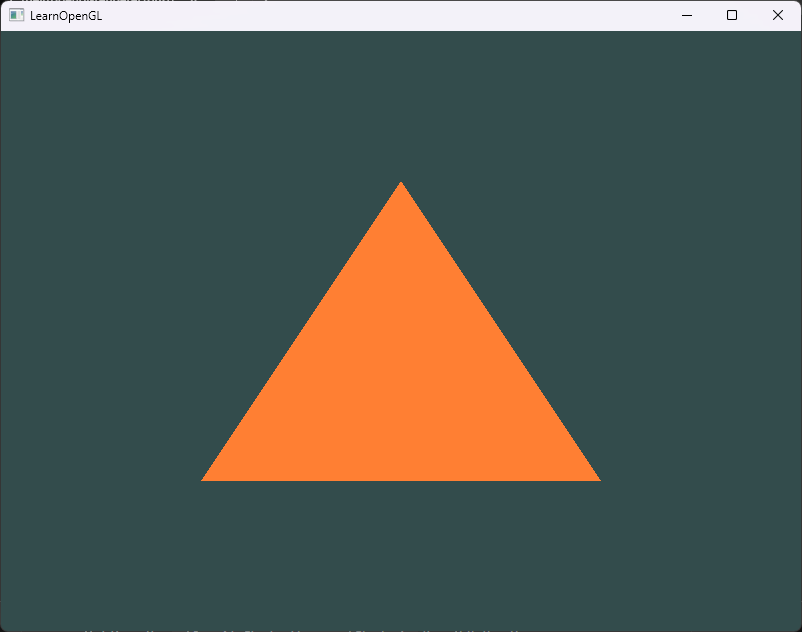

# OpenGL Renderer

A small real-time renderer in modern C++ and OpenGL 3.3 core, built while I work through [LearnOpenGL](https://learnopengl.com/). The goal is a lit 3D scene with my own shaders and a free-fly camera.

## Progress

 

### Getting started
- [ x ] Hello Window
- [ x ] Hello Triangle
- [ ] Shaders
- [ ] Textures
- [ ] Transformations
- [ ] Coordinate Systems
- [ ] Camera

### Lighting
- [ ] Colors
- [ ] Basic Lighting (Phong)
- [ ] Materials
- [ ] Lighting Maps
- [ ] Light Casters
- [ ] Multiple Lights

## Technologies
- C++20, CMake
- OpenGL 3.3 core profile
- [GLFW](https://www.glfw.org/) 3.4 (window, context, input)
- [glad](https://github.com/Dav1dde/glad) 0.1.36 (OpenGL loader)
- [GLM](https://github.com/g-truc/glm) 1.0.1 (maths)

## Build and run

GLFW and GLM are downloaded by CMake (`FetchContent`). The glad loader is in `external/glad`.

Windows (Visual Studio):

```
cmake -S . -B build
cmake --build build --config Debug
build\Debug\opengl-renderer.exe
```

Linux:

```
cmake -S . -B build -DCMAKE_BUILD_TYPE=Debug
cmake --build build
./build/opengl-renderer
```

Linux needs the usual GLFW build packages (for example X11/Wayland development headers).

### How glad was generated

```
pip install glad==0.1.36
python -m glad --profile core --api gl=3.3 --generator c --out-path external/glad
```

## What I learned

- How to set up a modern OpenGL 3.3 core profile context with GLFW and glad
- How to draw a triangle with OpenGL 3.3 core profile
- How to draw a rectangle with an Element Buffer Object (EBO)

## Credits

Based on the [LearnOpenGL](https://learnopengl.com/) tutorials by Joey de Vries.
