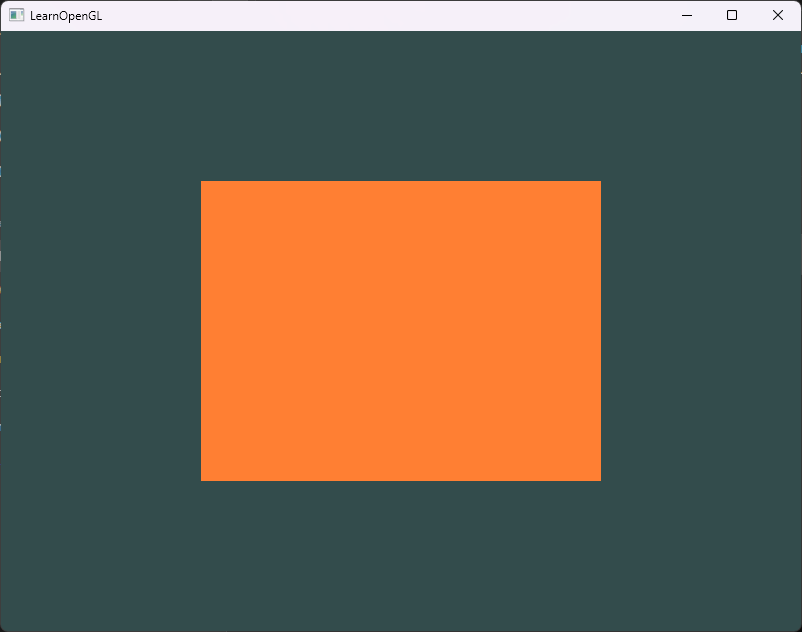

# OpenGL Renderer

A small real-time renderer in modern C++ and OpenGL 3.3 core, built while I work through [LearnOpenGL](https://learnopengl.com/). The goal is a lit 3D scene with my own shaders and a free-fly camera.

## Screenshots

| Hello Triangle | Hello Rectangle (EBO) |
|---|---|
|  |  |

## Progress

### Getting started
- [x] Hello Window
- [x] Hello Triangle (triangle, then a rectangle with an EBO)
- [ ] Shaders
- [ ] Textures
- [ ] Transformations
- [ ] Coordinate Systems
- [ ] Camera

### Lighting
- [ ] Colors
- [ ] Basic Lighting (Phong)
- [ ] Materials
- [ ] Lighting Maps
- [ ] Light Casters
- [ ] Multiple Lights

## What I learned
- **Context setup:** create an OpenGL 3.3 core profile context with GLFW, and load the OpenGL functions with glad before any GL call.
- **Render loop order:** input, clear, draw, then swap buffers and poll events. If you draw after the swap, the next clear erases the frame.
- **Buffers:** a VBO holds vertex data on the GPU. A VAO stores how that data is read (`glVertexAttribPointer`) and which EBO is bound.
- **Indexed drawing:** an EBO lets two triangles share vertices, so a rectangle needs 4 vertices instead of 6 (`glDrawElements`).
- **Shaders:** compile a GLSL vertex and fragment shader, link them into a program, and check the compile and link logs.

## Technologies
- C++20, CMake
- OpenGL 3.3 core profile, GLSL 330
- [GLFW](https://www.glfw.org/) 3.4 (window, context, input)
- [glad](https://github.com/Dav1dde/glad) 0.1.36 (OpenGL loader)
- [GLM](https://github.com/g-truc/glm) 1.0.1 (maths)

## Build and run

**Prerequisites:** CMake 3.20 or later, a C++20 compiler (Visual Studio 2022 or later, GCC or Clang), Git, and a GPU with OpenGL 3.3 support. CMake downloads GLFW and GLM (`FetchContent`). The glad loader is already in `external/glad`.

```bash
git clone https://github.com/ieuan-phillips/opengl-renderer.git
cd opengl-renderer
```

Windows (Visual Studio):

```powershell
cmake -S . -B build
cmake --build build --config Debug
build\Debug\opengl-renderer.exe
```

Linux:

```bash
cmake -S . -B build -DCMAKE_BUILD_TYPE=Debug
cmake --build build
./build/opengl-renderer
```

On Linux, GLFW needs the X11 and Wayland development packages. See the [GLFW compile guide](https://www.glfw.org/docs/latest/compile.html).

### How glad was generated

```bash
pip install glad==0.1.36
python -m glad --profile core --api gl=3.3 --generator c --out-path external/glad
```

## Credits

Based on the [LearnOpenGL](https://learnopengl.com/) tutorials by Joey de Vries.